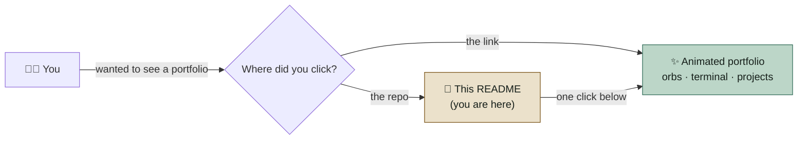

  

<h3 align="center">👋 Hey. You opened the <i>repo</i>.</h3>

  Not the website. The repo. 
  The one with the <code>.md</code> file. On purpose. Respect, honestly.

  

---

### 📍 You are here

### 🧪 What you're missing right now

| In this repo 📄 | On the website ✨ |
| :--- | :--- |
| Static text | Drifting background orbs that never stop vibing |
| `index.html` you'd have to read | A terminal that types out who I am |
| Zero animations | A changelog, projects, stats, and a blinking cursor |
| You, judging the commit history | You, actually impressed |

---

<b>Okay, you've had your fun. The real thing is one click away:</b>

  

  or copy it like it's 2009: <code>https://YOUR-PORTFOLIO-LINK-HERE</code>

---

🤓 <b>Fine, you're here for the code. Click for the tech notes.</b>

 

- **One file.** The whole site is a single `index.html`: no framework, no build step, no `node_modules` black hole.
- **Animations are pure CSS.** Background orbs are blurred circles on `@keyframes`, the terminal is staggered `animation-delay`s, and the cursor uses `step-end`.
- **Accessible motion.** Everything switches off under `prefers-reduced-motion`.
- **Hosted on GitHub Pages.** Push to `main` and it's live.

  
  
  

status: all systems operational · Colombo, LK · built calmly ☕

